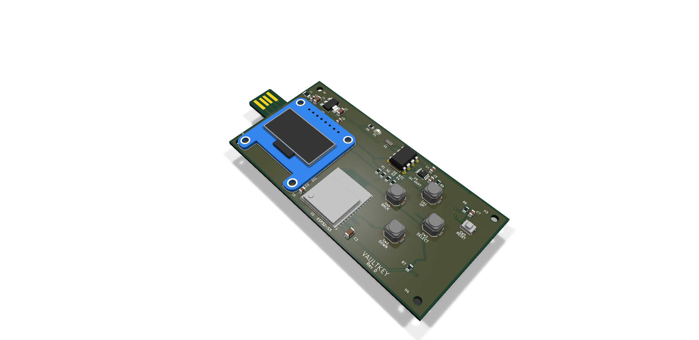

# VaultKey USB

> **This README is also generated by an AI agent cuz why not. All those PCB designing that i ain't used to and coding are enough for me!**



VaultKey USB is a compact ESP32-S3 hardware-key PCB with a native USB-A edge
connector, 128x64 OLED, four navigation buttons, a recessed reset switch, and a CR2032-backed DS1307 real-time
clock. This project targets **KiCad 10** and includes the routed PCB, matching
schematic, project rules, manufacturing data, assembly data, reports, STEP
model, and documentation plots.

## Validation status

The release artifacts in this directory were generated with KiCad 10.0.8.

| Check | Result |
|---|---:|
| PCB DRC | **0 violations, 0 unconnected pads** |
| PCB pad connectivity | **0 unconnected pads after GND stitching via** |
| Schematic ERC | **0 violations** |
| Schematic-to-PCB comparison | **105 connected pins, 0 mismatches** |
| Board outline | **112.500 x 50.000 mm** |
| Copper layers / thickness | **2 / 1.600 mm** |
| USB D+/D- routed-length mismatch | **6.625 mm** |
| USB-A PCB-edge pad order/geometry | **PASS** |

Rev E adds TP1 BOOT-to-GND recovery pads and MCU GPIO1 control of the green
status LED. Existing component placement and board outline are unchanged. The
current PCB passes DRC after copper-zone refill. Gerbers, drill files, and
fabrication archives are regenerated from this board. Validate the assembled
hardware before production use.

The machine-generated reports are under `fabrication/reports/`.
Cosmetic silkscreen-to-copper, silkscreen-overlap, and silkscreen-edge checks
are intentionally set to ignore in the project rules; electrical, clearance,
hole, courtyard, connectivity, and copper-edge checks remain enabled.

## Mechanical definition

- Overall coordinate bounds: `X=0..112.5 mm`, `Y=0..50.0 mm`.
- Main body: `X=12.0..112.5 mm`, **100.5 x 50.0 mm**.
- USB-A tongue: `X=0..12.0 mm`, `Y=19.0..31.0 mm`, with 0.5 mm 45-degree
  tip chamfers.
- Four 2.7 mm NPTH mounting holes:
  - H1 `(16.0, 3.5)`
  - H2 `(15.0, 47.0)`
  - H3 `(108.5, 3.5)`
  - H4 `(108.0, 46.0)`
- Two-layer, 1.6 mm FR4. All vias are tented on both sides.
- Contact finish: standard ENIG; hard-gold edge plating is not specified for
  this low-cycle prototype. Confirm insertion-cycle requirements with the
  fabricator and USB host connector.
- Front and rear silkscreens include component references; controls and major
  blocks also carry functional labels for assembly and use.

The required USB, display, module, RTC, and four D-pad placements remain at
their locked source coordinates. See
`fabrication/reports/mechanical_validation.txt` for the exact check output.

## Circuit overview

### Power and USB

- USB VBUS passes through F1, a 0.5 A resettable fuse, to the `+5V` rail.
- U3 (AMS1117-3.3) produces `+3V3` with 10 uF input and 22 uF output bulk
  capacitance.
- U5 (USBLC6-2SC6, bottom side) protects USB D+, D-, and VBUS from ESD.
- C9 provides local post-fuse USB input bypassing.
- D1 is an active-high MCU status LED driven by GPIO1 through R5 (1 kΩ).
- J1 is a true front-copper PCB-edge USB-A plug. The four contacts lie on the
  `X=0..12 mm` tongue. With the insertion tip facing left, top-to-bottom order
  is GND, D+, D-, VBUS. The connector pads run toward the body in +X. VBUS/GND are
  7.0 mm long; D-/D+ are recessed to 6.0 mm for make-first/break-last mating.
- Copper-zone fill and silkscreen are excluded from the complete mating tongue.

### Controller and controls

- U1 is an ESP32-S3-WROOM-1U module; connect an appropriate external 2.4 GHz
  antenna to its RF connector.
- Native USB uses module pins USB_D- and USB_D+.
- R6 (10k) pulls EN high and C7 (100nF) provides the RC delay, so the module
  leaves reset automatically when USB power is applied.
- SW5 is a small SMD tactile switch from EN to GND, recessed under a pinhole in
  the enclosure and operated with a needle or SIM-ejector tool. It is not a
  finger-operated reset button.
- R7 (10k) holds GPIO0 high for normal flash boot. TP1.1 is BOOT and TP1.2 is
  GND; bridge them while pulsing SW5/EN to enter ROM recovery mode. Remove the
  bridge after the ROM USB device appears. Validate this sequence on hardware.
- Enclosure reset access: SW5 sits on the front side at (104.0, 13.5) mm. Put a
  1.0-1.2 mm pinhole in the lid directly above that point; the switch body is
  4.2 x 3.2 mm and 2.5 mm tall, so it is not reachable by a finger. Press it
  with a needle or SIM-ejector tool. The pinhole is clear of H3/H4, the OLED,
  the four user buttons, the USB tongue and the ESP32 antenna.

Firmware-facing control assignment:

| Function | ESP32-S3 signal |
|---|---|
| Select | GPIO4 |
| Down | GPIO5 |
| Back | GPIO6 |
| Up | GPIO7 |
| OLED SDA | GPIO8 |
| OLED SCL | GPIO9 |
| OLED reset | GPIO13 |
| Boot | GPIO0 |
| Status LED | GPIO1 |

### OLED and RTC

- DS1 is the Adafruit 1.3-inch SSD1306 128x64 breakout footprint. Configure
  the module for I2C operation.
- OLED pin 7 (VIN) uses +5 V, pins 3 (DC/SA0) and 5 (CS) are strapped low,
  and pin 6 (the breakout's 3.3 V output) is intentionally unconnected.
- U2 is a 5 V DS1307+ with a 32.768 kHz crystal and bottom-side CR2032 backup.
- U4 (PCA9306) translates between the 3.3 V ESP32/OLED bus and the 5 V RTC
  bus. Both sides have 4.7 kOhm pull-ups.
- PCA9306 pins VREF2 and EN share `I2C_BIAS`; R8 (200 kOhm) biases that node
  from +5 V and C5 (100 pF) filters it, following the TI reference circuit.

## Important assembly notes

1. **Battery polarity:** BT1 is a bottom-side Keystone 1058/1058TR low-profile
   slot-style holder. Pad 1 is `VBAT` (+) and pad 2 is GND (-); confirm the
   procured holder's marking before inserting a cell.
2. **OLED mounting:** the OLED is installed on its 8-pin header. The four
   OLED-module corner drills have intentionally been removed from the carrier
   PCB; only the four main-board mounting holes remain.
3. **USB current/thermal margin:** validate worst-case ESP32 radio current,
   polyfuse behavior, AMS1117 dissipation, and enclosure temperature in the
   final product. The 0.5 A input fuse is deliberately conservative.
4. The project-local U1 STEP file is an **assembly-envelope model**, not
   vendor-controlled mechanical CAD. Its U.FL connector end matches the KiCad
   footprint, but do not use the model to machine mating parts.
5. The locked stackup is 1.6 mm FR4. Confirm mechanical retention and contact
   wear with the intended USB-A receptacle before production.

## Project structure

| Path | Contents |
|---|---|
| `VaultKey_USB.kicad_pro` | KiCad project and DRC/ERC settings |
| `VaultKey_USB.kicad_sch` | Complete matching schematic |
| `VaultKey_USB.kicad_pcb` | Fully routed two-layer PCB |
| `lib/VaultKey.pretty/` | Custom USB edge, NPTH, and hole-free OLED footprints |
| `lib/VaultKey.3dshapes/` | Project-local ESP32 assembly-envelope STEP model |
| `fabrication/gerbers/` | X2 Gerbers for copper, mask, paste, silk, and outline |
| `fabrication/drill/` | Separate plated/NPTH Excellon and drill maps |
| `fabrication/assembly/` | BOM and component-position CSV files |
| `fabrication/reports/` | DRC, ERC, netlist, IPC-D-356, drill, and statistics reports |
| `fabrication/3d/` | Complete board STEP export |
| `docs/` | Schematic PDF, 1:1 PCB plots, SVGs, and 3D renders |
| `generator/` | Deterministic source data and validation/export scripts |

The regenerated package is available at:
`fabrication/VaultKey_USB_Gerbers_and_Drill.zip`. Verify its contents against
your fabricator's layer naming and stackup requirements before ordering.
`fabrication/VaultKey_USB_Manufacturing_Package.zip` additionally contains the
BOM, placement files, reports, IPC-D-356 data, STEP model, and this README.

## Open and export

Open `VaultKey_USB.kicad_pro` in KiCad 10. To reproduce all validation and
release artifacts:

```bash
cd /home/rootx/Projects/VaultKey_USB
python3 generator/export_fabrication.py
```

This requires `kicad-cli`, the KiCad `pcbnew` Python module, and `FreeCADCmd`
for the two project-local envelope models.

The final PCB is already routed. `generator/build_pcb.py` intentionally
recreates an **unrouted** board and overwrites `VaultKey_USB.kicad_pcb`; use it
only when starting a new routing pass. The `.dsn`/`.ses` files in
`fabrication/` are retained as initial FreeRouting history and are not the
authoritative final board after the documented post-route corrections.

## Manufacturing constraints

- Minimum track width: 0.20 mm
- Minimum clearance: 0.20 mm
- Minimum copper-to-edge: 0.50 mm
- Hole clearance: 0.25 mm
- Hole-to-hole minimum: 0.25 mm
- Standard via: 0.60/0.30 mm
- Power via: 0.80/0.40 mm

See `fabrication/MANUFACTURING_NOTES.txt` for the concise release notes sent
with the Gerber archive.
Detailed USB pad measurements and connectivity checks are recorded in
`fabrication/reports/USB_contact_verification.txt`.


